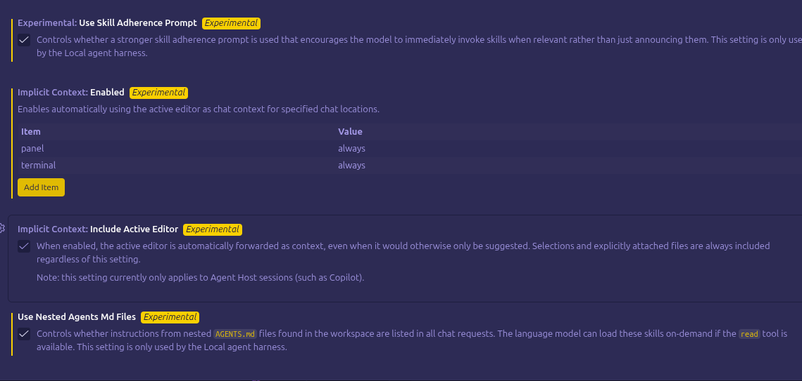
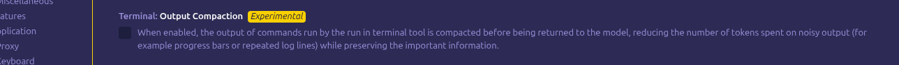
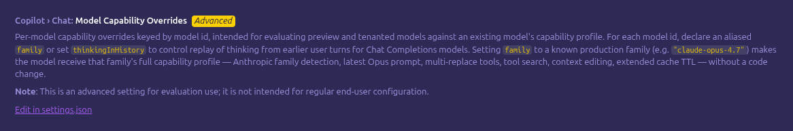
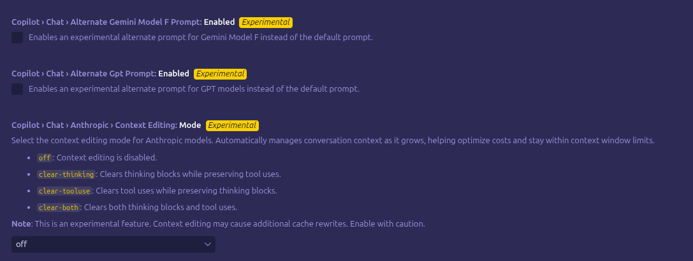
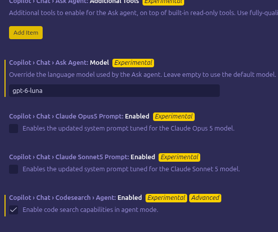
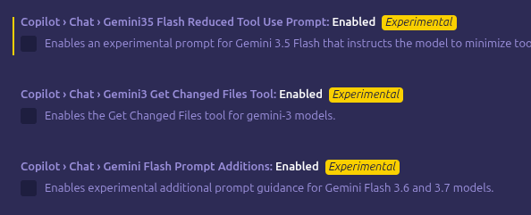

# Evidence Catalog — Settings Screenshots and Scope

The repository retains nine author-supplied screenshots of agent and model settings in VS Code. Original filenames, image dimensions, sizes and SHA-256 fingerprints are documented in [manifest.json](manifest.json). File names suggest October 31, 2026 but do not authenticate system time, release version, or request execution.

**Critical distinction:** a visible option—even one marked enabled—does not establish that it applied to a particular request. Product descriptions sometimes expressly limit features to the **Local harness** or **Agent Host**. This is a selected screenshot series, not a complete settings audit or a trace of an actual model request.

## S01 — Instruction inclusion

**Observed:** both boxes checked; descriptions refer to Local and matching `applyTo` / referenced instruction behavior. **Not established:** which files, if any, were actually transmitted.

## S02 — Skills, implicit context and nested instructions

**Observed:** Skill Adherence Prompt checked; implicit `panel` and `terminal` context set to `always`; Include Active Editor checked; Use Nested Agents Md Files checked. **Important limit:** the latter describes finding/listing instructions and on-demand loading, not necessarily inclusion of every nested file on every call. Local and Agent Host scopes differ.

## S03 — Tool output compression

**Observed:** `Compress Output` checked (Preview); description says post-process tool results such as `git diff`, `ls -l` or `npm install`. **Not established:** that the typed user prompt was rewritten, that data was lost, or that this feature handled a particular request.

## S04 — Terminal compaction disabled

**Observed:** experimental command-output compaction unchecked. It cannot be asserted as active in this capture.

## S05 — Model capability overrides

**Observed:** an advanced control describing model ID capability overrides. No active override value visible. The UI warns it is for evaluation rather than regular users.

## S06 — Attachment summarization omission disabled

**Observed:** experimental omission setting unchecked. No indication attachments were actually suppressed.

## S07 — Alternative model prompts and context editing disabled

**Observed:** alternative Gemini and GPT prompts unchecked; Anthropic context-editing mode `off`. These are examples of an expanding **configuration surface**, not evidence of active modifications.

## S08 — Ask Agent model and code search

**Observed:** a model identifier present in Ask Agent field, some provider-specific prompt options unchecked, code search enabled. UI values do not prove backend model resolution.

## S09 — Gemini options disabled

**Observed:** three Gemini prompt/tool options unchecked. Some descriptions are cropped; missing text is not reconstructed.

## Primary example: defensive global instructions

The author explicitly supplied the original Codex global instructions for publication as a research example. The text and its interpretation are in [Case Study A](../case-studies/defensive-global-instructions.md). It is evidence of the **author's stated protective intent and chosen textual guardrails**, not evidence of the message role assigned by a particular harness.

## Why these images accompany the account

These screenshots are **not evidence of prompt injection**, a compromised client, an adversarial extension, an unauthorized rewrite, or any actual model-policy violation. Their intended evidentiary role is much narrower:

**They document the number and heterogeneity of configuration controls through which an IDE, extension, app, skill or harness may potentially select instructions, include context, or transform intermediate content before an LLM receives an effective request.**

Multiple options control distinct operations and execution contexts. Some are enabled; others are disabled. The available images do not prove which settings affected any particular request, and cannot establish a longitudinal growth rate.

This complexity can be difficult for a user to track. It raises two kinds of **conditional uncertainty**:

1. **Suppression:** a transformation or context-management step might omit relevant information, causing the model to answer without a necessary constraint or warning.
2. **Addition:** an automatic instruction source might introduce directions that conflict with the user's explicit operating preferences, potentially changing the resulting output or action.

Neither scenario is claimed to have occurred here. They are questions raised by the visible configuration surface. A checked option does not prove execution, and tool-output compression does not mean the original user message was edited.

If a materially altered effective request ultimately leads to a policy, contractual, or operational violation, **the mere association of that request with a user's account does not establish who authored or knowingly authorized the instruction responsible**. The [main account](../paper.md) asks researchers to consider how responsibility can be fairly attributed without assuming automatic user innocence or automatic user culpability.

The [verbatim global instructions](../case-studies/defensive-global-instructions.md) are preserved separately as the author's defensive response to this uncertainty, not as an injection payload.
