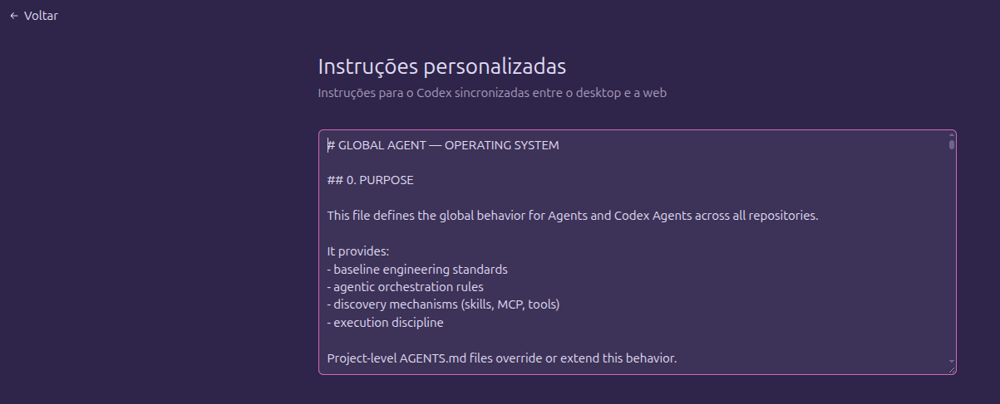

# Evidence Catalog — Settings Screenshots and Scope

The repository retains ten author-supplied screenshots: nine captures of VS Code AI settings and one Codex Web personalization view. Original filenames, image dimensions, sizes and SHA-256 fingerprints are documented in [manifest.json](manifest.json). File names suggest October 31, 2026 but do not authenticate system time, release version, or request execution.

**Critical distinction:** a visible option—even one marked enabled—does not establish that it applied to a particular request. Product descriptions sometimes expressly limit features to the **Local harness** or **Agent Host**. This is a selected screenshot series, not a complete settings audit or network trace.

## S01 — Instruction inclusion

**Observed:** both boxes checked; descriptions refer to Local and matching `applyTo` / referenced instruction behavior. **Not established:** which files, if any, were actually transmitted.

## S02 — Skills, implicit context and nested instructions

**Observed:** Skill Adherence Prompt checked; implicit `panel` and `terminal` context set to `always`; Include Active Editor checked; Use Nested Agents Md Files checked. **Important limit:** the latter describes finding/listing instructions and on-demand loading, not necessarily inclusion of every nested file on every call. Local and Agent Host scopes differ.

## S03 — Tool output compression

**Observed:** `Compress Output` checked (Preview); description says post-process tool results such as `git diff`, `ls -l` or `npm install`. **Not established:** that the typed user prompt was rewritten, that data was lost, or that this feature handled a particular request.

## S04 — Terminal compaction disabled

**Observed:** experimental command-output compaction unchecked. It cannot be asserted as active in this capture.

## S05 — Model capability overrides

**Observed:** an advanced control describing model ID capability overrides. No active override value visible. The UI warns it is for evaluation rather than regular users.

## S06 — Attachment summarization omission disabled

**Observed:** experimental omission setting unchecked. No indication attachments were actually suppressed.

## S07 — Alternative model prompts and context editing disabled

**Observed:** alternative Gemini and GPT prompts unchecked; Anthropic context-editing mode `off`. These are examples of an expanding **configuration surface**, not evidence of active modifications.

## S08 — Ask Agent model and code search

**Observed:** a model identifier present in Ask Agent field, some provider-specific prompt options unchecked, code search enabled. UI values do not prove backend model resolution.

## S09 — Gemini options disabled

**Observed:** three Gemini prompt/tool options unchecked. Some descriptions are cropped; missing text is not reconstructed.

## S10 — Codex Web personalization

**Observed:** a Web settings page promises Codex instructions synchronized between desktop and web, with text headed “GLOBAL AGENT — OPERATING SYSTEM.” The author reports that the Codex Desktop Linux editor displayed different, more recently edited instructions. **Not established:** whether both screens should reference the same storage object or whether synchronization failed; this requires a controlled bidirectional test with versions, account/host and saved timestamps.

## Primary example: defensive global instructions

The author explicitly supplied the original Codex global instructions for publication as a research example. The text and its interpretation are in [Case Study A](../case-studies/defensive-global-instructions.md). It is evidence of the **author's stated protective intent and chosen textual guardrails**, not evidence of the message role assigned by a particular harness.

## Why these images accompany the account

The screenshots are included as **context for a personal uncertainty about instruction composition and authority**, not as evidence of a security incident. They illustrate how an ordinary user encounters settings governing instruction selection, implicit context, extension behavior, and transformations without necessarily knowing what reached the model in an individual session.

The central story concerns the author's attempt to defend global operating preferences with the phrase `IMMUTABLE`, followed by concern that this defensive wording might appear to conflict with instruction hierarchy or alignment expectations. The [full first-person account](../paper.md) and [verbatim instructions](../case-studies/defensive-global-instructions.md) explain that sequence.

No screenshot proves malicious injection, covert prompt rewriting, misalignment classification, or a confirmed Desktop/Web synchronization defect. **This repository does not propose any testing framework or specific investigation protocol**; it invites independent researchers to interpret the evidence through their own methods.
