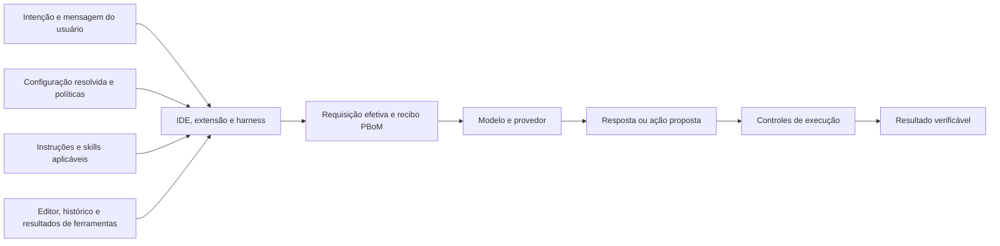

# A conta da configuração: complexidade, integridade do prompt e produtividade de agentes em IDEs

**The Configuration Tax of IDE Agents: Prompt Bills of Materials, Drift, and Productivity Break-even**

Juninho De Luca · versão 0.1.0 · 31 de outubro de 2026  
Paper técnico de posição e proposta metodológica. Redação e pesquisa assistidas por IA. Não revisado por pares.

## Resumo

O benefício de um agente de programação depende de mais do que a capacidade do modelo. A IDE, a extensão, o runtime do agente, as instruções locais e globais, as skills, as ferramentas e as políticas de execução participam da construção do comportamento. Sua composição pode exigir trabalho recorrente de configuração, diagnóstico e supervisão. Este paper investiga como tornar esse trabalho observável e como avaliar quando ele consome o ganho de produtividade prometido. Usamos nove capturas de opções do VS Code, uma captura adicional de personalização e relatos de uso como estudo motivador, distinguindo-os de fatos documentados e hipóteses. Propomos um perfil de Prompt Bill of Materials (PBoM) por requisição, um modelo de break-even com amortização de implantação e manutenção, e um benchmark que separa capacidade, qualidade, atenção humana, espera, tokens e custo. As evidências disponíveis demonstram uma superfície de configuração heterogênea em um ambiente particular. Não demonstram crescimento diário, comprometimento de integridade, defeito de sincronização ou perda causal de produtividade. A contribuição é tornar essas alegações testáveis e formular requisitos de produto que reduzam o trabalho necessário para entender e operar um agente.

**Palavras-chave:** agentes de programação; VS Code; GitHub Copilot; Codex; configuração; proveniência; prompt integrity; PBoM; context overhead; configuration drift; produtividade.

## Abstract

Coding-agent productivity depends on the composition of the IDE, extension, agent harness, model, instructions, skills, tools, and execution policies. Configuring, auditing, and maintaining that composition may consume part of the time saved on implementation. This position paper uses nine VS Code settings screenshots, one additional personalization screenshot, and practitioner reports as a motivating case, explicitly separating observations, documented behavior, and untested hypotheses. We propose a request-level Prompt Bill of Materials profile, an amortized productivity break-even model, and a benchmark methodology that measures accepted work, human attention, waiting, token usage, and cost separately. We acknowledge prior PBoM work and do not claim to originate the term. Our material establishes the presence of heterogeneous configuration surfaces in one environment; it does not establish daily growth, prompt tampering, synchronization failure, or a causal productivity loss. No new productivity experiment was executed. The contribution is a falsifiable measurement and observability framework rather than a general claim that coding agents improve or reduce developer productivity.

## 1. O problema: desenvolver ou administrar o assistente

A motivação nasce de uma pergunta prática: quanto tempo o desenvolvedor pode gastar configurando o assistente antes de o assistente deixar de economizar tempo?

No diálogo que originou este trabalho, o autor descreveu a sensação de ter de escolher entre abrir a IDE para desenvolver e passar o dia administrando o agente. A expressão “Full Model Setter for VS Code” ironiza a possibilidade de a operação do assistente se transformar em uma especialidade própria. A referência a oito horas por dia é uma formulação retórica de saturação, não um diário de uso ou uma média observada.

O argumento merece investigação mesmo quando formulado com humor. Um recurso pode ter valor individual e ainda aumentar o custo de compreender o conjunto. O problema proposto não é o número bruto de botões: é a distância entre a intenção do usuário e a configuração que efetivamente orienta cada ação.

Adotamos uma tese condicional: **a complexidade de configurar, compreender e manter agentes pode consumir o ganho de produtividade que esses agentes produzem na implementação**. “Pode” é essencial. Customizações bem escolhidas também podem evitar erros, reduzir explicações repetidas e melhorar resultados. O saldo precisa ser medido no trabalho aceito, com qualidade equivalente.

Este paper oferece quatro contribuições: um registro de evidências com limites explícitos; uma definição operacional de proveniência e integridade; um perfil de PBoM orientado à composição de requisições em IDEs; e um desenho de medição econômica e experimental. Não oferece um ranking de produtos nem um resultado causal novo.

## 2. Método e classes de afirmação

O material empírico é pequeno e intencionalmente limitado: nove capturas de opções do VS Code, uma captura de personalização relacionada ao Codex e trechos relevantes de uma conversa fornecida pelo autor. As imagens foram recuperadas em seu formato recebido e estão no [catálogo de evidências](evidence/README.md). Não dispomos de gravação da sessão, exportação da configuração efetiva, captura de rede, histórico de atualizações ou inventário exato de versões.

A pesquisa documental consultou fontes oficiais dos produtos, uma especificação do MCP, documentação da Hugging Face, material da NTIA, a implementação anterior de PBoM da EqoAI e estudos primários de produtividade. O corte documental é 31/10/2026. Documentação em URLs mutáveis pode mudar depois desse corte. Este é um levantamento dirigido ao problema, não uma revisão sistemática da literatura.

| Classe | Significado neste paper | Exemplo |
| --- | --- | --- |
| O — observação | Conteúdo diretamente legível no material recebido | Uma caixa aparece marcada em S03 |
| D — fato documentado | Comportamento descrito por fonte primária, com escopo próprio | O runtime descobre determinadas fontes de instruções |
| R — relato | Afirmação do autor ou de terceiro, sem instrumentação independente | Volume de tokens mencionado na palestra |
| H — hipótese | Relação ainda não testada | Mais manutenção reduz o ganho líquido |
| P — proposta | Mecanismo ou método sugerido por este trabalho | Recibo de composição por requisição |
| S — cenário sintético | Número escolhido para explicar o modelo | Implantação de 180 minutos no exemplo |

Uma observação de interface não se converte automaticamente em evidência de execução. Um comportamento documentado não prova que ocorreu naquela sessão. Um cenário sintético não é um resultado de benchmark.

## 3. O que as capturas mostram

As nove imagens principais cobrem famílias distintas de controles. O quadro resume somente estados legíveis; o [catálogo](evidence/README.md) contém os arquivos, detalhes e limitações.

| Captura | Observação direta | Limite da inferência |
| --- | --- | --- |
| S01 | Include Applying Instructions e Include Referenced Instructions marcados; descrição menciona Local | Não informa quais arquivos foram enviados |
| S02 | Skill Adherence e Nested Agents Md marcados; contexto implícito com `panel` e `terminal` em `always`; Include Active Editor marcado | As descrições distinguem Local de Agent Host; não provam uso simultâneo |
| S03 | Compress Output marcado, com selo Preview | O texto descreve pós-processamento de saídas de ferramentas |
| S04 | Terminal Output Compaction desmarcado | Não é evidência de que esse mecanismo compactou uma saída |
| S05 | Model Capability Overrides visível, classificado como Advanced | Não há valor de override visível; a própria descrição limita seu uso pretendido |
| S06 | Omit File Attachment Contents desmarcado | Não demonstra omissão de anexos na sessão |
| S07 | Prompts alternativos Gemini e GPT desmarcados; context editing em `off` | Recursos expostos não equivalem a recursos ativos |
| S08 | Campo Ask Agent: Model preenchido; Code Search marcado; opções Claude desmarcadas | Um identificador visível não comprova qual modelo atendeu uma requisição |
| S09 | Três opções Gemini de prompt/ferramentas desmarcadas | Parte das descrições está cortada à direita |

A captura adicional S10 mostra uma tela Web que anuncia instruções para Codex sincronizadas entre desktop e web e exibe um texto de instruções. O autor relatou conteúdo diferente no Desktop. Falta, neste conjunto, uma captura pareada do Desktop com identificação de conta, host, versão, horário e objeto editado. Portanto, há um **relato de divergência**, acompanhado de uma promessa visível na interface, mas não uma reprodução de defeito de sincronização.

Três correções são necessárias em relação a interpretações mais fortes do diálogo. Primeiro, listar arquivos `AGENTS.md` para carregamento sob demanda não é o mesmo que inserir integralmente todos eles em todas as requisições. Segundo, comprimir uma saída de terminal não prova reescrita do texto digitado pelo usuário. Terceiro, opções explicitamente desativadas não explicam um comportamento observado sem evidência adicional.

Também não se pode inferir uma série temporal a partir de um conjunto transversal de imagens. A impressão de que surgem opções diariamente é R, não O. Seria preciso comparar versões e datas com uma regra estável de contagem para medir crescimento.

## 4. O modelo é apenas uma parte do sistema

Usamos **harness** para o runtime que monta o contexto, chama o modelo, disponibiliza ferramentas e coordena a execução. IDE, extensão, harness, provedor e modelo são dimensões diferentes. Um modelo escolhido na IDE não determina sozinho quais formatos de customização o runtime lê.

A documentação do VS Code distingue instruções, skills, agentes, MCP, hooks e plugins. Ela também distingue orientação interpretada pelo modelo de ações disparadas pelo runtime. Isso sustenta a análise da composição; não implica que toda customização seja necessária ou prejudicial. [Fonte oficial: customização](https://code.visualstudio.com/docs/agents/concepts/customization).

No Codex, a documentação descreve descoberta de `AGENTS.md` global e por diretório, arquivos de override e limite de tamanho. Outra página documenta camadas de configuração e restrições de confiança. São mecanismos relacionados, mas distintos: **precedência de valores de configuração não é a mesma coisa que autoridade de mensagens no modelo**. [Instruções](https://learn.chatgpt.com/docs/agent-configuration/agents-md), [configuração](https://learn.chatgpt.com/docs/config-file/config-basic).

Um mapa analítico útil é:



O diagrama é uma abstração proposta, não a arquitetura interna comprovada de todos os produtos. Em particular, parte da montagem pode ocorrer no servidor e permanecer invisível ao cliente.

O inventário deve distinguir pelo menos sete estados: disponível, instalado, habilitado, elegível para a tarefa, carregado, enviado ao modelo e seguido na execução. Saltar entre esses estados produz diagnósticos frágeis. Uma skill instalada pode nunca ser selecionada; uma instrução enviada pode não ser cumprida; uma ação desejada pelo modelo pode ser bloqueada pelo runtime.

## 5. Complexidade de configuração: medir interações, não apenas opções

Definimos complexidade de configuração como o trabalho necessário para escolher, prever, explicar, manter e reproduzir a configuração efetiva de um agente para uma tarefa. É uma definição operacional proposta, com dimensões observáveis:

| Dimensão | Medida candidata | Como evitar uma conclusão enganosa |
| --- | --- | --- |
| Superfície | Quantidade de controles relevantes expostos e efetivamente ativos | Separar controles de outros modelos, runtimes e estados inativos |
| Dispersão | Número de superfícies e escopos envolvidos | Diferenciar conta, host, perfil, workspace e repositório |
| Interação | Dependências e conflitos de ativação | Medir relações reais, não presumir todas as combinações possíveis |
| Explicabilidade | Tempo para identificar origem, valor efetivo e razão de inclusão | Usar uma pergunta concreta com resposta de referência |
| Volatilidade | Mudanças efetivas por atualização ou unidade de tempo | Separar alteração deliberada de mudança inesperada |
| Manutenção | Atenção humana gasta em migração e recuperação | Evitar contabilizar a mesma intervenção duas vezes |
| Reprodutibilidade | Proporção de execuções com ambiente suficientemente identificado | Registrar o que o provedor não permite fixar |

Para `k` opções binárias independentes existem `2^k` combinações teóricas. Essa identidade não estima o custo humano: muitas combinações são inválidas, irrelevantes ou nunca exploradas. A topologia das dependências e a qualidade dos padrões podem importar mais do que `k`.

Por isso não propomos, nesta versão, um índice único com pesos arbitrários. Preferimos publicar as dimensões separadas e relacioná-las a tarefas diagnósticas: “qual instrução determinou esta validação?”, “por que este arquivo foi anexado?” ou “o que mudou desde a execução anterior?”. O tempo e a taxa de acerto nessas tarefas são mais interpretáveis do que uma contagem isolada.

## 6. Proveniência, autoridade e integridade do prompt

**Proveniência** responde de onde veio um componente, quem o publicou, qual versão foi carregada e por qual caminho chegou à requisição. **Autoridade** responde em que condições esse componente pode orientar ou restringir a tarefa. **Integridade** responde se a composição e as transformações respeitaram o contrato declarado e as autorizações aplicáveis.

Essas propriedades não são intercambiáveis. Uma origem conhecida não autoriza qualquer instrução. Uma assinatura pode vincular bytes a uma chave, mas não demonstrar que o conteúdo é seguro ou que o usuário desejava aplicá-lo. Da mesma forma, a palavra `IMMUTABLE` escrita em um arquivo não muda, por si só, o papel de transporte desse arquivo nem cria enforcement técnico.

O objetivo do autor ao proteger certas instruções era preservar economia de contexto e previsibilidade diante de fontes auxiliares. Esse objetivo é legítimo como requisito de produto. Saber se uma regra específica prevalece exige conhecer o contrato do runtime e a camada em que a regra foi efetivamente apresentada. O nome “system instructions” em uma conversa ou arquivo não basta para determinar essa camada.

Propomos distinguir quatro situações:

| Situação | Critério operacional | Evidência necessária |
| --- | --- | --- |
| Composição esperada | O runtime aplica fontes previstas e pertinentes | Registro de inclusão e política aplicável |
| Conflito de instruções | Duas orientações relevantes pedem comportamentos incompatíveis | Fontes, escopos e decisão de resolução |
| Transformação inesperada | O conteúdo enviado diverge do contrato ou da expectativa verificável | Antes/depois, versão e regra de transformação |
| Prompt injection | Conteúdo de menor confiança tenta redirecionar a tarefa ou adquirir autoridade indevida | Conteúdo, fronteira de confiança e comportamento induzido |

Uma configuração pode produzir custo ou surpresa sem constituir ataque. Uma tentativa de injeção também pode falhar e ainda ser uma tentativa. As imagens deste estudo não demonstram um ataque bem-sucedido. A documentação de segurança do Codex reconhece riscos de instruções não confiáveis e distingue controles de execução de preferências textuais. [Fonte oficial](https://learn.chatgpt.com/docs/agent-approvals-security).

A analogia com arquivos de modelos da Hugging Face é limitada. A documentação da plataforma descreve execução arbitrária associada ao carregamento de `pickle`. Aqui, a preocupação é elevar conteúdo auxiliar a orientação operacional. Ambos exigem atenção à fronteira entre conteúdo e ação, mas os mecanismos e as evidências são diferentes. Não inferimos comprometimento de IDE a partir do caso de desserialização. [Pickle Scanning](https://huggingface.co/docs/hub/security-pickle).

O MCP, por sua vez, atribui ao host responsabilidades por permissões, consentimento e agregação de contexto. Isso é relevante para localizar o controle da composição; não é prova de que toda implementação cumpra essas responsabilidades ou de que o protocolo resolva prompt injection. [Arquitetura MCP, edição 2025-06-18](https://modelcontextprotocol.io/specification/2025-06-18/architecture/index).

## 7. O que “integridade” deve preservar

Preservar integridade não significa proibir qualquer transformação. Seleção de contexto, serialização, resumos e compactação podem ser necessários. O requisito proposto é que transformações materiais tenham finalidade, escopo e rastreabilidade proporcionais ao efeito.

Convém separar quatro objetos: a mensagem digitada; os anexos resolvidos; o histórico preservado ou resumido; e os resultados de ferramentas. Uma transformação em um desses objetos não prova alteração nos demais.

Um contrato verificável deveria permitir responder: o texto original foi mantido? Quais referências foram resolvidas? Qual conteúdo foi omitido? Uma saída comprimida preservou o sinal relevante para a tarefa? O que foi substituído por resumo? Quando a resposta não puder ser observada, o sistema deve representar a lacuna como desconhecida.

Hashes antes e depois permitem detectar diferença entre bytes observados, mas não provam equivalência semântica. Um resumo com hash correto ainda pode omitir uma restrição decisiva. A avaliação precisa incluir invariantes de tarefa e casos de perda de informação, além de identidade de conteúdo.

Esse requisito também vale para instruções que tentam economizar trabalho. Proibir toda releitura ou validação pode reduzir um contador e aumentar o retrabalho. O benchmark deve preservar a qualidade de aceitação e medir o saldo; uma redução de tokens que piora a entrega não é um ganho automaticamente válido.

## 8. Prompt Bill of Materials: do inventário ao recibo de composição

A analogia com SBOM é uma lista estruturada de componentes e relações. A NTIA descreve esse papel no contexto da cadeia de software; estendê-lo a prompts é uma proposta analítica, não uma exigência normativa derivada do relatório. [NTIA, 2021](https://www.ntia.gov/report/2021/minimum-elements-software-bill-materials-sbom).

O termo **Prompt Bill of Materials** já tem uso anterior. O projeto [EqoAI/pbom-spec](https://github.com/EqoAI/pbom-spec) descreve registros de interações, fingerprints e encadeamento de hashes. Seu README explicita limites de autoria e da âncora externa. Este paper reconhece esse antecedente e propõe requisitos adicionais de composição para IDEs, sem alegar compatibilidade ou a criação do termo.

Um inventário de plugins instalados não explica uma requisição concreta. Propomos dois níveis relacionados: um descritor de ambiente e política, relativamente estável; e um recibo por chamada ao modelo, incluindo chamadas de subagentes quando existirem. O recibo deve representar tanto componentes incluídos quanto candidatos excluídos relevantes para explicar uma decisão.

| Grupo | Campos propostos |
| --- | --- |
| Identidade | Sessão, requisição, agente, chamada pai e horário |
| Ambiente | Cliente, extensão, harness, modelo, revisão disponível e commit do projeto |
| Origem | Tipo de fonte, publicador, versão e escopo sanitizado |
| Ativação | Gatilho, padrão aplicável, seleção explícita ou automática e motivo |
| Composição | Ordem, papel de transporte observado, estado de inclusão e relações |
| Transformação | Entrada e saída, operador, motivo e fingerprint quando permitido |
| Política | Regra que decidiu inclusão, exclusão, precedência ou autorização |
| Contabilidade | Tokens, origem da contagem, cache e categorias não observáveis |
| Lacunas | Componentes ocultos, metadados indisponíveis e completude declarada |

A versão de desenho está em [docs/pbom-profile.md](docs/pbom-profile.md). O [JSON de exemplo](examples/pbom.example.json) é sintético, não foi emitido por VS Code ou Codex e não é uma captura desta sessão. O namespace é próprio; um mapeamento para EqoAI exigiria análise e validação posteriores.

O PBoM deve registrar a política realmente aplicada, não inventar uma hierarquia universal. Deve também distinguir “enviado ao modelo” de “seguido pelo modelo”. O primeiro pode ser observado no limite de inferência; o segundo requer evidência de comportamento.

A parte proprietária do prompt pode continuar opaca. Nesses casos, o recibo deve declarar o limite de observação e, quando disponível, uma versão ou atestação do provedor. Ausência de acesso não autoriza afirmar que a contagem parcial representa o prompt inteiro.

Por fim, o recibo deve existir no plano de observabilidade do host, com consulta sob demanda. Inserir o manifesto integral no próprio contexto em toda chamada pode aumentar justamente o custo investigado. O benefício do mecanismo deve ser comparado ao seu custo de coleta, armazenamento e interpretação.

## 9. Context overhead e token overhead

**Context overhead** é a parcela do orçamento de contexto dedicada à operação e à orientação do agente, em vez dos dados imediatos da tarefa. **Token overhead** é o processamento adicional associado a essa operação ao longo das chamadas. São categorias de análise propostas; parte desse overhead pode ser útil e evitar trabalho futuro.

Uma decomposição conceitual da entrada é:

```text
entrada = mensagem do usuário + instruções + definições de ferramentas
        + material da tarefa + histórico + serialização/protocolo
```

A atribuição exata depende do tokenizer e da serialização. Tokenizar blocos isolados nem sempre produz a soma da requisição completa. O protocolo deve publicar a regra de atribuição e um resíduo, ou marcar as categorias como estimadas. Não se deve apresentar uma contagem local parcial como uso faturado pelo provedor.

Se um bloco estático de `b` tokens aparece integralmente em `r` chamadas, ele contribui aproximadamente `r × b` tokens de entrada processada sob essas condições. Compactação, truncamento, prefixos diferentes e formas de transporte mudam esse cálculo. Cache pode alterar processamento e cobrança; não torna automaticamente esse material irrelevante para o contexto.

A documentação do VS Code explica que histórico, instruções, arquivos e resultados usam a janela de contexto, e que compactação pode resumir ou omitir detalhes. Isso fundamenta medir retenção de informação, além de tamanho. [Contexto em agentes](https://code.visualstudio.com/docs/agents/concepts/context).

A contabilidade precisa separar tokens de entrada, entrada em cache e saída. Na documentação da OpenAI consultada, cached tokens já integram input tokens e reasoning tokens já integram output tokens. Não devem ser somados novamente. Uso ausente é desconhecido, não zero, e a contabilização de uma API não se transfere automaticamente para uma assinatura de IDE. [Observability and usage](https://developers.openai.com/api/docs/guides/agents-api/observability).

Quando o contrato de preço usa taxas separadas para entrada não cacheada, entrada cacheada e saída, um cálculo ilustrativo é:

```text
C_modelo = Σ [ (I − Ic) × pu + Ic × pc + O × po ] / 1.000.000
```

`I` é entrada total, `Ic` sua parcela cacheada, `O` saída e `p` a taxa correspondente por milhão de tokens. Tarifas de escrita de cache, ferramentas e outros itens precisam de adaptação ao contrato real, sem contagem duplicada. Não fixamos preços nesta versão. Créditos, requisições e limites de assinatura devem ser contabilizados em suas unidades nativas.

Os relatos de quase 6 bilhões de tokens individuais e 4 bilhões em quatro meses para 80 pessoas não permitem comparar eficiência. Falta o período do primeiro número, além de categorias, modelos, preço, tarefas, qualidade, cache, paralelismo e unidade de medição. Também não demonstram que expiração de limites ou renovação de cotas corresponda a desperdício econômico. **Quantidade de tokens não é produtividade.**

## 10. Configuration drift

Chamamos de drift a divergência entre uma configuração de referência e a configuração efetiva posterior. Ela pode vir de uma alteração deliberada, sincronização, instalação, atualização, mudança de padrão, modelo substituído ou resolução de outro escopo. Drift não é sinônimo de defeito: o problema é a mudança material não percebida, não desejada ou difícil de explicar.

A documentação do VS Code descreve configurações de usuário e workspace, enquanto Settings Sync tem cobertura e limitações próprias. Isso recomenda registrar escopo e mecanismo de sincronização em vez de presumir uma configuração única para todo cliente. [Settings](https://code.visualstudio.com/docs/configure/settings), [Settings Sync](https://code.visualstudio.com/docs/configure/settings-sync).

Propomos distinguir quatro tipos: drift de conteúdo, quando os bytes mudam; de resolução, quando a mesma configuração passa a selecionar fontes diferentes; de política, quando a regra de ativação ou precedência muda; e de comportamento, quando o resultado muda apesar de os registros disponíveis parecerem iguais.

O último tipo exige cuidado. Amostragem do modelo, estado remoto, conteúdo do editor e condições de rede podem mudar resultados sem alteração local. Uma alias de modelo estável não prova backend imutável. Esses casos devem ser tratados como limitações ou variáveis não controladas, não automaticamente atribuídos à IDE.

No episódio Desktop/Web, a investigação correta começaria identificando quais objetos cada editor modifica e qual contrato de sincronização se aplica. Depois compararia snapshots pareados, conta, host, perfil, horário e versão, com marcadores inofensivos e possibilidade de restauração. O material recebido ainda não permite concluir se houve fontes distintas, atraso, cache ou bug.

## 11. Modelo de break-even de produtividade

O referencial deve ser uma tarefa concluída com critérios equivalentes de aceitação. Reduzir tempo entregando trabalho incompleto não satisfaz o modelo.

Para uma tarefa `j`, defina `THj` como o tempo humano da condição sem IA, incluindo sua revisão e correção. Na condição com IA, separe: `Ej`, execução e interação produtiva; `Vj`, verificação; `Rj`, retrabalho; `Cj`, configuração específica; `Aj`, auditoria da composição; e `Wj`, espera exclusiva em que não há trabalho humano ativo nessa tarefa. Todas as categorias de atenção são mutuamente exclusivas.

Defina ainda `αj`, entre zero e um, como a fração de espera que representa capacidade humana perdida. Uma espera inteiramente aproveitada em outra atividade tem peso próximo de zero; bloqueio efetivo tem peso próximo de um. Registre o método usado para estimar esse peso e publique análises de sensibilidade. Tempo de calendário é um resultado separado.

Para um horizonte com `N` tarefas:

```text
G_N = Σ [THj − (Ej + Vj + Rj + Cj + Aj + αj × Wj)] − F − M_N
```

`F` é o investimento inicial de implantação e aprendizado; `M_N`, manutenção recorrente que ainda não foi classificada em `Cj` ou `Aj`. O ganho `G_N` é positivo quando há economia líquida de capacidade humana. Não se deve somar a mesma sessão de diagnóstico em auditoria e manutenção.

Para tarefas aproximadamente comparáveis, seja `b` a média do termo entre colchetes. Se a manutenção média é `m` por tarefa, então:

```text
G_N = N × (b − m) − F

N* = teto[F / (b − m)], quando b − m > 0
```

`N*` é o primeiro inteiro que atinge saldo não negativo sob essas premissas. Se a divisão for exata, a vantagem estrita só aparece depois de `N*`. Se `b − m ≤ 0` e `F > 0`, não há amortização finita nesse regime. Aprendizado, tarefas heterogêneas e mudanças de ferramenta tornam necessária a forma geral por horizonte.

### 11.1 Exemplo exclusivamente sintético

Todos os tempos abaixo são escolhidos para demonstrar a conta, em minutos por tarefa. Não são observações dos screenshots ou estimativas dos produtos.

| Componente | Ambiente estável | Ambiente com maior manutenção |
| --- | ---: | ---: |
| Referência sem IA, `TH` | 90 | 90 |
| Execução/interação, `E` | 45 | 45 |
| Verificação, `V` | 15 | 15 |
| Retrabalho, `R` | 5 | 5 |
| Configuração, `C` | 6 | 12 |
| Auditoria, `A` | 4 | 10 |
| Espera exclusiva, `W` | 8 | 8 |
| Peso da espera, `α` | 0,25 | 0,25 |
| Economia antes da manutenção, `b` | 13 | 1 |
| Manutenção por tarefa, `m` | 3 | 5 |
| Margem por tarefa, `b − m` | 10 | −4 |
| Implantação inicial, `F` | 180 | 180 |
| Break-even | 18 tarefas | Não existe nesse regime |

O exemplo mantém o trabalho de implementação igual e altera configuração, auditoria e manutenção. Ele ilustra a tese condicional, sem estimar sua frequência no mundo real. Com `α = 1`, o primeiro cenário teria margem de 4 minutos e break-even de 45 tarefas; com `α = 0`, margem de 12 minutos e break-even de 15 tarefas. A oportunidade de reaproveitar a espera muda a conclusão econômica.

### 11.2 Tempo não é o mesmo que dinheiro

Uma tradução financeira simples, para taxa de trabalho `w` por hora e tempos convertidos em horas, é:

```text
ganho financeiro = w × G_N
                 − custo incremental de modelos e ferramentas
                 − licenças e infraestrutura incrementais
```

Não somar tokens a dinheiro, nem tratar assinatura já paga como tarifa marginal por token. Se o objetivo for prazo de entrega, usar tempo de calendário e dependências do trabalho, não apenas atenção humana. Se houver mudança de qualidade, medir defeitos e retrabalho posterior antes de concluir que a economia inicial persistiu.

## 12. Benchmark: separar capacidade, operação e manutenção

Propomos três braços: H, desenvolvimento sem IA generativa; A, agente com configuração padrão documentada; e G, o mesmo agente com configuração governada, fontes explícitas e recibos de composição quando tecnicamente possíveis. O contraste G−A avalia o pacote de governança; A−H e G−H avaliam o efeito líquido nas condições estudadas.

O protocolo detalhado está em [docs/benchmark-protocol.md](docs/benchmark-protocol.md). A governança inclui trabalho de configuração e auditoria no seu próprio custo. Se não reduzir o custo total, não deve ser anunciada como solução de produtividade apenas porque tornou os logs melhores.

Os experimentos devem usar tarefas de correção localizada, mudança de contrato e trabalho que atravessa componentes. Cada tarefa precisa de critérios de aceitação definidos antes da execução. A avaliação pode usar verificações automatizadas e revisão humana cegada para a condição quando possível. Linhas geradas, mensagens trocadas e velocidade de resposta não substituem trabalho aceito.

Participantes devem ser distribuídos por experiência com o projeto e com agentes. A ordem das condições deve ser randomizada e balanceada. O mesmo participante não deve resolver novamente a mesma tarefa com a solução já conhecida. Variantes precisam ser calibradas; “mesma categoria” não garante dificuldade equivalente.

O piloto sugerido é de oito participantes e seis tarefas distintas por participante, duas em cada condição, sujeito a viabilidade e consentimento. Esse número é uma proposta operacional, não uma demonstração de poder estatístico. O estudo principal deve dimensionar amostra a partir da variância do piloto e de uma diferença mínima de interesse previamente declarada.

Não atribuir ao harness uma diferença de modelos. Comparações dentro de um runtime devem manter modelo e esforço de raciocínio constantes quando isso for possível. Se produtos não disponibilizarem modelos e ferramentas equivalentes, o resultado é uma comparação de pacotes de produto, identificada como tal.

Ablações posteriores devem variar um mecanismo por vez, ou usar um desenho fatorial explícito: contexto implícito, inclusão de instruções e compressão de saídas são candidatos. Testar apenas mecanismos suportados pelo runtime escolhido. Não ativar controles experimentais de outros modelos para aumentar artificialmente a complexidade.

Para medir drift, um segundo estudo deve acompanhar snapshots de versões ao longo do tempo, com uma coorte estável e outra exposta a atualizações em janelas registradas. A comparação de diferenças pode ser exploratória; atualização não randomizada traz confundidores. Contar novidades diariamente sem controlar renomeações, migrações e escopo não basta.

## 13. Instrumentação e análise

O resultado principal proposto é capacidade humana consumida até uma entrega aceita, com falhas e tarefas interrompidas preservadas na análise. O desfecho de qualidade deve ser reportado junto ao tempo: comparar somente execuções bem-sucedidas pode selecionar artificialmente os melhores casos de um braço.

Tempos de execução, configuração, auditoria, verificação e retrabalho devem vir de uma linha do tempo, com categorias exclusivas e regra publicada. No experimento controlado inicial, limitar cada participante a uma tarefa por vez facilita a medição. Uma etapa ecológica posterior pode incluir trabalho simultâneo, mas precisa alocar atenção sem duplicá-la entre tarefas.

Cada chamada ao modelo deve ter um identificador associado à tarefa. O ledger de requisições evita perder chamadas de subagentes, retries e compactação. Esses eventos podem ter custo mesmo quando não aparecem como uma resposta final. O endpoint e o limite de observação precisam ser descritos, respeitando autorização e privacidade.

O VS Code oferece uma Chat Debug view para inspecionar detalhes de interações, incluindo prompts e contexto nas situações suportadas. O protocolo deve aproveitar instrumentos existentes e registrar sua cobertura, sem presumir que todas as chamadas ou componentes de servidor sejam visíveis. [Debug chat interactions](https://code.visualstudio.com/docs/agents/agent-troubleshooting/chat-debug-view).

Para análise, reportar diferenças absolutas e relativas com intervalos de confiança, considerando participante e tarefa como fontes de dependência. Um bootstrap por agrupamento ou modelo de efeitos mistos pode ser escolhido antes do estudo principal. Não tratar centenas de requisições de poucos desenvolvedores como centenas de participantes independentes.

Pré-registrar hipóteses, desfecho primário, orçamento por tarefa, exclusões, tratamento de falhas e método de qualidade. Separar análises confirmatórias de explorações. A dimensão temporal é importante: relatar sessões iniciais, regime estabilizado e recuperação após mudanças, em vez de esconder implantação e manutenção fora do cronômetro.

## 14. Hipóteses falsificáveis

| ID | Hipótese | Evidência que a enfraqueceria |
| --- | --- | --- |
| H1 | Maior dispersão de configuração aumenta o tempo de diagnóstico, controlada a tarefa | Diagnóstico igualmente rápido e correto com mais superfícies |
| H2 | Contexto automático irrelevante aumenta consumo sem melhorar aceitação | Ganho de aceitação ou redução de trabalho que compense o consumo |
| H3 | Recibos PBoM reduzem tempo para explicar inclusões e drift | Custo de interpretação igual ou maior sem melhoria de acerto |
| H4 | Atualizações que alteram resolução elevam manutenção no curto prazo | Ausência de aumento após mudanças documentadas, com boa sensibilidade de medição |
| H5 | Em parte dos regimes, a soma dos custos operacionais elimina a economia da implementação | Ganho líquido positivo robusto no domínio e horizonte estudados |
| H6 | Compressão pode perder informação relevante em certos tipos de saída | Retenção de invariantes e qualidade equivalentes nos casos pré-definidos |

Nenhuma dessas hipóteses foi testada por este repositório. Uma hipótese sobre certos regimes não pode ser “confirmada” apenas mostrando um caso extremo selecionado. Frequência, magnitude e condições de ocorrência também importam.

## 15. Relação com pesquisas de produtividade

Peng e coautores relatam, em experimento de 2023 com implementação de um servidor HTTP em JavaScript, que o grupo com Copilot completou a tarefa 55,8% mais rapidamente na formulação do estudo. Esse resultado demonstra benefício naquele desenho, não um valor universal para agentes atuais ou seu custo de administração. [Artigo primário](https://arxiv.org/abs/2302.06590).

O estudo da METR publicado em julho de 2025 encontrou aumento de 19% no tempo de tarefas de desenvolvedores experientes em seus próprios projetos, em condições específicas do início de 2025. Não mediu isoladamente a configuração como causa. [Relatório primário](https://metr.org/blog/2025-07-10-early-2025-ai-experienced-os-dev-study/).

A atualização da própria METR, de fevereiro de 2026, alerta que o experimento posterior sofreu seleção de participantes e tarefas, além de dificuldades para medir trabalho concorrente. Seus autores consideram o sinal pouco confiável para quantificar o efeito corrente. Isso impede usar o resultado anterior como estimativa atual genérica. [Atualização metodológica](https://metr.org/blog/2026-02-24-uplift-update/).

Essas fontes não são uma meta-análise: diferem em ferramentas, população, tarefas, época e definição de resultado. Sua função aqui é demonstrar por que métricas contextualizadas e desenho experimental são necessários. O novo benchmark deve isolar o custo de operação que essas comparações não identificam diretamente.

## 16. Requisitos de produto derivados da proposta

Os requisitos seguintes são propostas de engenharia, não alegações de que os produtos carecem integralmente desses recursos.

1. **Configuração efetiva explicável.** Mostrar valor, origem, escopo, política e runtime para uma tarefa concreta.
2. **Recibo de composição.** Explicar inclusões, exclusões e transformações materiais sem exigir leitura de todos os diretórios.
3. **Mudanças relevantes visíveis.** Comparar o estado efetivo antes e depois de atualizações, distinguindo padrão, override e migração.
4. **Orçamento de contexto por categoria.** Expor medição e incerteza, sem confundir tamanho de janela, consumo acumulado e cobrança.
5. **Autoridade e autorização separadas.** Evitar que texto auxiliar se promova a política apenas por declarar prioridade.
6. **Escopo de sincronização claro.** Identificar se uma preferência pertence à conta, máquina, perfil, repositório ou ambiente remoto.
7. **Inspeção proporcional.** Resumos úteis e detalhes sob demanda, com custo do próprio diagnóstico mensurável.

O usuário não deveria precisar dominar uma cadeia inteira de resolução para descobrir por que uma tarefa simples acionou um fluxo diferente do esperado. Ao mesmo tempo, exigir confirmação a cada transformação pode aumentar a carga operacional. A proposta é controle por política explícita, padrões compreensíveis e destaque a mudanças materiais, com possibilidade de auditoria detalhada.

## 17. Limitações, privacidade e conclusões

O estudo motivador tem um único autor e capturas selecionadas. Não há amostragem da população, série temporal, medição de tempo ou telemetria independente. Não conhecemos a versão exata da IDE e extensões nas imagens nem o harness ativo em uma chamada específica. Os rótulos e padrões documentados podem diferir entre versões. Os arquivos originais têm nomes com data, mas isso não constitui uma cadeia de custódia autenticada.

Proveniência também pode expor dados. Caminhos, nomes de projetos, prompts, ferramentas e resultados podem conter informação privada. Um PBoM deve minimizar coleta e retenção, permitir redação e representar lacunas. Hashes simples de conteúdo previsível podem permitir comparação ou adivinhação; fingerprints não são anonimização. A publicação de um benchmark deve separar artefatos públicos de registros restritos autorizados.

Ambientes hospedados podem impedir fixação completa de modelos, captura integral de prompts ou reprodução determinística. Esses limites precisam acompanhar qualquer resultado. Um recibo completo do lado cliente ainda pode ser incompleto do lado servidor.

A conclusão sustentada por esta versão é limitada e útil: a configuração observada reúne mecanismos com efeitos e escopos distintos, e sua mera exposição na interface não permite reconstruir o comportamento efetivo. A tese de perda de produtividade permanece condicional e testável. O modelo de break-even e o protocolo propostos permitem investigar quando a capacidade do agente compensa seu trabalho de operação, e quando esse saldo deixa de ser positivo.

O objetivo é deslocar a discussão de “quantos tokens foram consumidos?” para “quanto trabalho de qualidade foi entregue, com qual custo total e com qual capacidade de explicar sua execução?”. As [fontes e seu alcance](references.md), o [catálogo de capturas](evidence/README.md) e o [protocolo](docs/benchmark-protocol.md) tornam essa discussão inspecionável.
